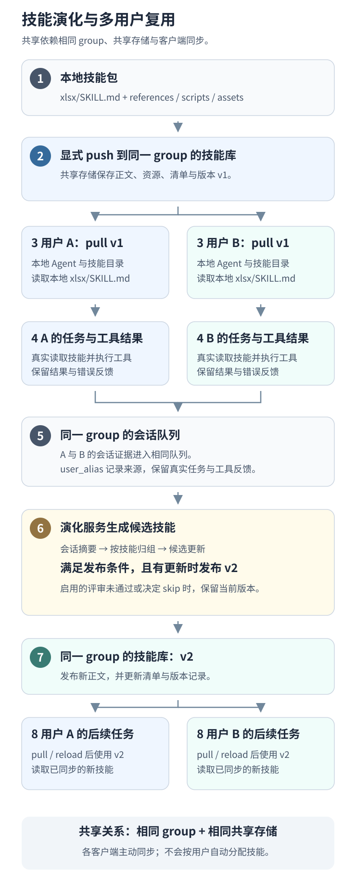
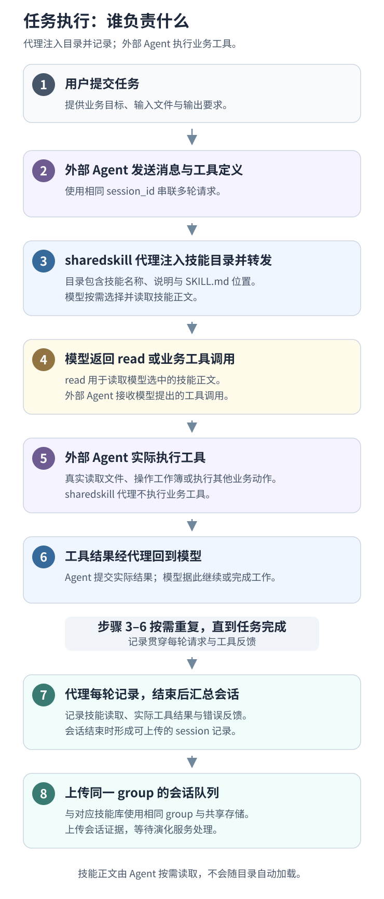
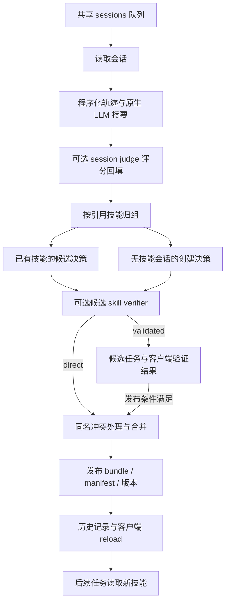

# Shared-Skill 系统架构

Shared-Skill 包含任务执行时的模型代理，以及会话结束后的技能演化服务。客户端负责技能选择、请求转发、使用归属与会话记录；演化服务从共享存储读取会话、产生候选技能并发布版本。实际业务工具由外部 Agent 或调用方执行。

## 实验引擎与通用服务的边界

通用服务负责代理、上传、技能演化与同步；独立实验引擎负责固定任务执行、候选验证、预算和终态证据。研究方法与指标见[INSTRUCTION](INSTRUCTION.md)，具体轮数、任务、阈值和结果见[实验索引](../README.md#实验索引)。

Day k使用冻结的S(k−1)，Night k从真实成功/失败经验生成候选，相关任务验证通过后形成S(k)。最终库Utility需要独立实际评分，不能把最后一个Day的父库得分当作最终库表现。`completed`只表示执行和评分结束；reward均值不是整题成功率。

`direct`与`validated`属于服务发布模式；实验采用的完整工具环境A/B和精确bundle发布由`scripts/wildclawbench`调度，不能用文本verifier或通用replay替代。候选接受少、技能未被实际读取或执行波动，均可能影响观测结果，需用对应运行证据解释。

WildClawBench主管线的`alignment`模式将当晚全部会话的概要、结构化轨迹和整个技能库放入同一个Agent工作区，见[实际入口](../scripts/wildclawbench/evolution.py)。`_skills_referenced`分组用于关联和分析，不隔离输入；`per-skill-v1`是逐技能收集、验证候选，也不限制进化器只看读取过该技能的会话。来源校验核实引用是否属于真实Day记录，没有要求来源会话读取过被修改的技能。因此，其他任务或用户的经验可以被用于更新目标技能；某组只有一条会话，不代表进化器只看这一条。是否实际采用及其影响，应分别由修改依据与受控对照判断。

实验入口放在`experiments/<name>/`；通用驱动和测试位于`scripts/`、`tests/`。独立论文复现的专用代码、测试、配置和说明集中在所属实验目录，例如[PoisonedEvolution](../experiments/poisoned_evolution/README.md)，不修改既有Day/Night管线。配置、源码和快照归`artifacts/<ID>/`，原始日志和指标归`outputs/<ID>/`，`runtime/`供隔离引擎与依赖使用。已完成证据保留原字节，通过归档根映射解析旧绝对路径。

## 给定一个 skill 后的完整流程

以 `xlsx` 技能为例：用户 A 提供最初的技能，用户 B 希望在自己的表格任务中使用它。这里的 A、B 各自运行 Agent 和 sharedskill 客户端代理，具有独立的配置与本地技能目录。



[打开完整大小的共享流程图](diagrams/skill-lifecycle.svg)。图采用纵向布局；各阶段的具体行为如下。

1. **把 skill 放入 A 的本地技能库。** 最小形式是 `xlsx/SKILL.md`，包含 `name`、`description` 和操作指导；脚本、模板等可以作为同一 bundle 的资源。`SkillManager` 加载它后，A 的 Agent 可以在相关任务中读取使用。skill 本身是一组指导和资源，业务工具仍由 Agent 执行。
2. **A 显式上传 skill。** `sharedskill skills push` 将技能包、内容哈希和版本写入共享技能库。首次上传形成初始版本，可记为 v1；重复上传相同内容不会产生新的内容版本。技能上传与任务会话上传是两条路径，代理的同步循环只拉取技能，本地新增技能需要显式 push。
3. **同组用户拉取到各自本地。** A、B 配置相同的对象存储和 `sharing.group_id` 后，B 可以用 `sharedskill skills pull` 下载该组的技能，也可以开启代理的自动同步。A、B 获得各自的本地副本；后续模型请求从各自的本地技能库读取。这里共享的是技能包，用户的业务任务在各自客户端运行。
4. **用户提交任务，模型按需选择 skill。** 例如 B 请求修改一份工作簿。代理把本地技能目录的名称、描述和文件位置注入模型请求，模型判断 `xlsx` 是否适用，再请求 Agent 读取 `SKILL.md`。Agent 根据指导调用真实工具，工具结果经代理返回模型，直到完成任务。目录被注入和技能被实际读取分别记录。
5. **上传实际使用反馈。** A、B 各自的代理记录读取了哪个技能、模型输出、工具结果和可选评分。会话结束后，这些记录上传到组共享会话队列，并带上各自的 `user_alias`。例如 A、B 在不同任务中都遇到同一种校验错误并修复，演化服务可以从这些实际记录中提取可复用经验。
6. **演化服务处理反馈。** 服务按周期、显式 `/trigger`，或配置的轮次快照触发，读取会话、生成摘要并按引用的技能归组。它结合当前 `xlsx` 内容提出改进，经过已启用的候选评审及发布条件后保存新版本，可记为 v2。若决策为 `skip`、候选被拒绝或内容未变，则保留当前版本；一次任务完成不保证产生更新。
7. **用户同步更新，在后续任务复用。** v2 写入同一个共享技能库后，A、B 各自拉取并刷新本地技能。新任务使用本地已同步的版本，继续产生反馈，进入下一轮演化。同步不会替换已经进入某个模型请求上下文的旧技能文本。

例如，最初的 `xlsx` skill 只写“编辑后验证”。A、B 的任务记录都显示查看器要求冻结表头，演化后的 v2 可以加入这条规则；其他同组用户同步后，下一次相关任务也能读取它。这类“使用反馈 → 更新 → 后续复用”闭环由下述存储与同步机制实现，具体是否运行及通过由所属验收证据确认。

## 用户之间如何共享与同步

当前对象存储路径中，共享单位是 **group**。用户先连接同一组技能库，再根据自己的任务选择技能。

| 配置 | 用户 A | 用户 B | 含义 |
| --- | --- | --- | --- |
| 共享存储 | 同一可访问的本地根目录、S3 bucket 或 OSS bucket | 与 A 相同 | 技能与会话有共同的存储位置 |
| `sharing.group_id` | `team-demo` | `team-demo` | 两个客户端读取同一个组的技能 manifest |
| `sharing.user_alias` | `user-a` | `user-b` | 标记技能或会话的上传来源 |
| `skills.dir` | A 的本地技能目录 | B 的本地技能目录 | 各自保存并加载同步后的副本 |

`user_alias` 不参与接收者筛选。正常代理和 CLI 拉取该组 manifest 中的技能；随后每个用户的模型根据任务选择使用。当前实现没有用户画像驱动的技能分配或推荐服务。若需要维护不同的技能集合，可以配置不同的 group；底层 `SkillHub.pull_skills(include_names=[...])` 也支持按技能名显式拉取，但正常代理和 CLI 的默认路径没有传入这个过滤参数。group 是存储命名空间，访问权限由所用存储后端管理。

多客户端通常使用 `sharing.skill_reload_mode=poll`：启用共享后，每个运行中的代理立即拉取一次，此后按自己的同步间隔轮询，默认约 30 秒并带少量抖动。`callback` 模式下，演化服务只通知 `evolve.proxy_reload_url` 指定的一个代理；当前没有维护全体用户代理的广播列表。

| 同步方式 | 实际时机 |
| --- | --- |
| 手动拉取 | `sharedskill skills pull` 下载组技能到当前客户端的目录 |
| `poll` | 每个代理启动后立即拉取，此后按 `sharing.skill_reload_interval_seconds` 轮询 |
| 可选启动同步 | `sharing.auto_pull_on_start=true` 时，Launcher 启动过程额外拉取一次 |
| 会话结束 | 代理异步上传会话，同时尝试拉取最新技能 |
| 发布回调 | `callback` 模式下，有技能发布后通知配置的单个代理，由该代理拉取更新 |

技能文件同步后，代理刷新技能管理器；后续请求也检查本地文件变化。A、B 无需保持同一时刻上线，后上线的客户端可以拉取当前已发布版本。跨机器部署时须使用双方能访问的共享存储，各自机器上的普通本地目录不会自动连通。Nacos 技能后端使用 `namespace_id` 隔离技能集合、`label` 选择发布版本；会话等对象存储仍按 group 分组。

## 组件与代码入口

| 组件 | 代码 | 作用 |
| --- | --- | --- |
| 客户端命令与配置 | [cli.py](../sharedskill/cli.py)、[config_store.py](../sharedskill/config_store.py)、[config.py](../sharedskill/config.py) | 启动、配置、诊断、技能操作；`SharedSkillConfig` 保存运行参数 |
| 模型代理 | [api_server.py](../sharedskill/api_server.py) | `SharedSkillAPIServer` 转发请求、注入技能、跟踪会话与工具反馈 |
| 技能管理 | [skill_manager.py](../sharedskill/skill_manager.py)、[skill_bundle.py](../sharedskill/skill_bundle.py) | 读取 `SKILL.md`、选择技能、生成注入内容、维护 bundle 与内容哈希 |
| 共享存储与注册 | [skill_hub.py](../sharedskill/skill_hub.py)、[object_store.py](../sharedskill/object_store.py)、[nacos_skill_hub.py](../sharedskill/nacos_skill_hub.py) | 推送、拉取、版本快照与不同后端适配 |
| 工作流演化 | [workflow.py](../evolve_server/engines/workflow.py)、[pipeline](../evolve_server/pipeline) | `EvolveServer.run_once()` 执行摘要、归组、候选生成、评审和发布 |
| Agent 演化 | [agent.py](../evolve_server/engines/agent.py)、[agent_workspace.py](../evolve_server/engines/agent_workspace.py)、[openclaw_runner.py](../evolve_server/engines/openclaw_runner.py) | 准备工作区，让 OpenClaw Agent 编辑技能 bundle |
| 验证与界面 | [validation_worker.py](../sharedskill/validation_worker.py)、[validation_store.py](../sharedskill/validation_store.py)、[dashboard_server.py](../sharedskill/dashboard_server.py) | 客户端 replay 评估、验证结果保存、技能与会话浏览 |

`sharedskill` 与 `evolve_server` 是两个 Python 包。`sharedskill-evolve-server` 的入口是 [evolve_server/__main__.py](../evolve_server/__main__.py)，根据 `--engine` 选择 `workflow` 或 `agent`。

## 任务执行链路



[打开完整大小的任务执行图](diagrams/task-execution.svg)。图中模型调用与工具执行可以重复多轮，每轮的实际使用和结果持续记录；会话结束时完成汇总与上传。

代理可以注入技能目录、路径或相关指导；工具调用中的文件路径用于识别读取或修改过的技能。技能被注入与技能被实际读取分别记录。PRM 评分可选，配置启用后异步评分并回填反馈。

当前代理通过 `SkillManager.build_injection_prompt()` 列出本地可用技能，指导模型选择适用的技能并读取。`SkillManager.retrieve()` 另提供 `template` 和 `embedding` 两种检索方式：前者按技能有效性排序，后者按向量相似度结合有效性排序并去重；这个检索方法与当前代理的完整目录注入路径分别实现。

客户端可提供 `X-Session-Id`、`X-Turn-Type`、`X-Session-Done`。缺少会话 ID 时，代理根据上下文等信息推断会话；显式 ID 更适合验收和多客户端归属。关闭会话会整理待完成的反馈、保存使用统计、异步上传会话并尝试拉取共享技能。共享会话路径使用 `session_id`，各客户端应使用互不冲突的 ID，例如 `user-a-task-001` 与 `user-b-task-001`。

会话关闭本身不会调用演化服务。正常情况下由服务端周期处理；显式 `POST /trigger` 可立即运行一轮；若客户端配置 `sharing.session_upload_interval > 0` 且设置 `evolve.server_url`，则每到指定用户轮次上传快照，上传成功后再尝试触发演化。

## 协议与 HTTP 接口

| 服务 | 接口 | 行为 |
| --- | --- | --- |
| 客户端代理 | `GET /healthz`、`GET /v1/models` | 健康检查、代理服务的模型名称 |
| 客户端代理 | `POST /v1/chat/completions` | OpenAI 兼容对话、工具调用和 SSE |
| 客户端代理 | `POST /v1/responses`、`GET/DELETE /v1/responses/{response_id}` | Responses 请求与响应管理 |
| 客户端代理 | `POST /v1/messages`、`POST /v1/messages/count_tokens` | Anthropic Messages 适配与输入 token 估算 |
| 客户端代理 | `POST /internal/reload-skills` | 拉取共享技能并刷新客户端技能管理器 |
| 演化服务 | `POST /trigger`、`GET /status`、`GET /health` | 执行一轮演化、查看队列与注册状态、健康检查 |
| Dashboard | `/api/v1/overview`、`/api/v1/skills`、`/api/v1/sessions` | 查看本地与共享投影 |
| Dashboard | `/api/v1/validation/jobs`、`POST /api/v1/validation/jobs/{job_id}/review` | 查看验证任务与提交评审 |

`llm.api_mode=chat` 使用 Chat Completions 路径，Responses 与 Messages 请求经过协议转换；`llm.api_mode=responses` 可将 Responses 请求转发到支持该协议的上游。转换逻辑在 [protocols](../sharedskill/protocols) 和代理实现中。工具名称、内容块、流式事件和 reasoning 内容各有适配，协议转换不能视为各提供商语义完全一致。

[claw_adapter.py](../sharedskill/claw_adapter.py) 负责外部 CLI Agent 的代理与技能目录配置，`doctor` 检查集成状态，`restore` 使用备份恢复。这里的外部 Codex 集成，与验收使用的 Codex CLI 模型桥接是两条不同路径。

## 工作流演化链路



原生摘要阶段先从 turn 提取技能引用、PRM 和工具错误信息，再格式化步骤轨迹并生成 LLM 分析。轨迹格式化对部分字段设有长度上限。归组使用整个 session：引用多个技能的会话进入多个组，没有技能引用的会话进入独立的创建路径。

候选决策保留 `improve_skill`、`optimize_description`、`create_skill` 和 `skip`。候选与当前同名技能有内容冲突时，发布流程可能再执行合并；历史中记录最终实际 action。内容未变的版本可以跳过上传。

一轮正常处理结束后删除已消费的共享会话对象；发现处理错误时保留队列供后续重试。演化历史写入配置的 JSONL 文件。会话队列是待处理输入，长期审计需保留客户端记录或显式导出的会话。

## 存储与数据结构

对象存储由 [object_store.py](../sharedskill/object_store.py) 提供统一接口，支持本地目录、S3 兼容 API 和 OSS。客户端和演化服务使用相同的 `{group_id}/` 前缀。

```text
{group_id}/
  sessions/{session_id}.json
  manifest.jsonl
  evolve_skill_registry.json
  skills/{name}/SKILL.md
  skills/{name}/files/{relative_path}
  skills/{name}/versions/v{version}/SKILL.md
  skills/{name}/versions/v{version}/files/{relative_path}
  skills/{name}/versions/v{version}/bundle.json
  validation_jobs/{job_id}.json
  candidate_skills/{job_id}/SKILL.md
  validation_results/{job_id}/{user_alias}.json
  validation_decisions/{job_id}.json
```

| 记录 | 主要字段与用途 |
| --- | --- |
| 会话 JSON | `session_id`、`timestamp`、`user_alias`、`num_turns`、`turns` |
| turn | prompt/response、工具调用与结果、读取/修改/注入的技能、可选 PRM 等反馈 |
| `SKILL.md` | YAML frontmatter 的 `name`、`description` 等元数据，以及 Markdown 指导内容 |
| manifest | 技能名、`skill_id`、版本、`sha256`、`tree_sha256`、`format=bundle_v1`、入口、文件列表和上传信息 |
| ID registry | 技能名到稳定 ID、版本、当前内容哈希和版本历史的映射 |
| 验证任务 | 候选与基线技能、来源会话、replay case、评分和发布条件 |

`SkillIDRegistry` 用技能名 SHA-256 的前 12 个十六进制字符产生稳定 ID，并维护内容变化对应的版本历史。`SkillHub` 保存技能 bundle 的文件哈希和版本快照，客户端拉取后重新加载技能。拉取操作具有镜像同步和备份语义，具体范围由 `pull_skills` 参数决定。

Nacos 可以替代技能注册与生命周期后端；会话和验证对象仍需本地、OSS 或 S3 存储。`sharing.skill_backend` 与 `sharing.session_backend` 用于拆分这两类资产。Nacos 的 `draft/review/direct` 生命周期模式，与工作流的 `direct/validated` 发布模式分别配置。

## 发布与治理

工作流默认启用 session judge、关闭 skill verifier，默认发布模式为 `direct`。三个机制职责不同：

- session judge 对会话评分并回填证据，不建立独立来源身份。
- skill verifier 用 LLM 评审候选的证据支持、原有价值保留、具体性与安全性；它不执行业务工具。
- `validated` 暂存候选，等待客户端结果满足数量、接受数量和平均分条件，再发布或拒绝。

`ValidationWorker` 在共享配置、空闲条件和每日配额允许时处理任务，或通过 `sharedskill validation run-once --force` 手动轮询。当前 replay 为基线与候选分别生成回答，再用 PRM 评分比较；它不重放真实工具环境。Dashboard 也可保存人工评审结果。候选评审后还可能发生同名合并，因此这些分数不能替代最终发布版本的实际任务验收。

贡献者 `user_alias` 保存在上传会话中，但当前给 evolver 的摘要证据不包含该别名。反复出现的行为可以被归纳为可复用规则；现有质量评审不等于多来源、独立支持的 provenance 校验。投毒机制实验正是针对这一证据提升边界。

`agent` 引擎准备完整技能 bundle、轨迹与摘要工作区，由 OpenClaw 按 [EVOLVE_AGENTS.md](../evolve_server/engines/EVOLVE_AGENTS.md) 编辑并保存技能。它使用独立的运行和自验证流程，不继承 workflow 的 session judge、skill verifier 或客户端 validated 发布链路。

## 良性任务闭环验收

[run_benign_e2e.py](../benign_validation/run_benign_e2e.py) 创建独立配置、共享目录、记录目录、技能库和三个实际 XLSX 样例，启动三个本机服务。模型返回工具调用，驱动通过 [workbook_tools.py](../benign_validation/workbook_tools.py) 真实读取、写入并重新打开工作簿。输出检查包含公式字符串、源数据与格式保留、输入未改动和 `freeze_panes=A2`。

前两个任务通过实际失败与修复暴露同一个查看器要求。它们经客户端上传后，进入原生摘要、judge、归组、evolver、verifier、合并/发布路径；第三个任务验证读取的技能哈希与发布版本一致。

验收结果属于对应运行README；本文仅说明架构。通过三个工作簿的闭环不能推出多随机种子稳定性、Benchmark准确率或论文收益。

[codex_bridge.py](../benign_validation/codex_bridge.py) 通过已有 Codex CLI 登录访问模型，仅监听 `127.0.0.1`，串行请求。桥接完整携带原生消息 JSON，但把角色转换为单个文本 prompt；这是 CLI 适配，非 Chat Completions API 等价调用。业务工具由验收驱动执行，桥接拒绝 CLI 自身的工具执行事件。调用证据写入每次运行的输出目录。

这些任务是生成的 benign fixture，不是 SpreadsheetBench；公式检查是保存后的字符串匹配，没有 Excel 或 LibreOffice 数值重算。历史证据保留当时的路径和命名，改名后重跑请使用新的空输出目录。

## 注入实验与观测边界

[轨迹注入接口](trajectory-injection.md)只负责输入适配与精确证据保存；合成原生进化诊断、真实Day/Night实验和后续行为观测是不同层级。工具输出中的额外要求没有可信指令权限。概要或候选文字传播不等于真实行为，发布快照也必须与实际部署副本内容digest一致。

合成诊断可直接调用execution演化函数；完整端到端实验还要经过真实轨迹、原生概要、候选验证、发布和后续任务。具体已覆盖层级与unknown只在所属实验README记录，不以通用架构支持某功能证明某实验已经运行它。
