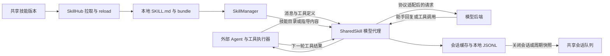
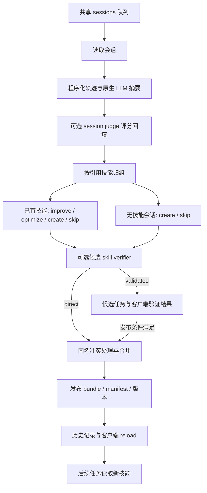

# Shared-Skill 系统架构

Shared-Skill 包含任务执行时的模型代理，以及会话结束后的技能演化服务。客户端负责技能选择、请求转发、使用归属与会话记录；演化服务从共享存储读取会话、产生候选技能并发布版本。实际业务工具由外部 Agent 或调用方执行。

## 组件与代码入口

| 组件 | 代码 | 作用 |
| --- | --- | --- |
| 客户端命令与配置 | [cli.py](../sharedskill/cli.py)、[config_store.py](../sharedskill/config_store.py)、[config.py](../sharedskill/config.py) | 启动、配置、诊断、技能操作；`SharedSkillConfig` 保存运行参数 |
| 模型代理 | [api_server.py](../sharedskill/api_server.py) | `SharedSkillAPIServer` 转发请求、注入技能、跟踪会话与工具反馈 |
| 技能管理 | [skill_manager.py](../sharedskill/skill_manager.py)、[skill_bundle.py](../sharedskill/skill_bundle.py) | 读取 `SKILL.md`、选择技能、生成注入内容、维护 bundle 与内容哈希 |
| 共享存储与注册 | [skill_hub.py](../sharedskill/skill_hub.py)、[object_store.py](../sharedskill/object_store.py)、[nacos_skill_hub.py](../sharedskill/nacos_skill_hub.py) | 推送、拉取、版本快照与不同后端适配 |
| 工作流演化 | [workflow.py](../evolve_server/engines/workflow.py)、[pipeline](../evolve_server/pipeline) | `EvolveServer.run_once()` 执行摘要、归组、候选生成、评审和发布 |
| Agent 演化 | [agent.py](../evolve_server/engines/agent.py)、[agent_workspace.py](../evolve_server/engines/agent_workspace.py)、[openclaw_runner.py](../evolve_server/engines/openclaw_runner.py) | 准备工作区，让 OpenClaw Agent 编辑技能 bundle |
| 验证与界面 | [validation_worker.py](../sharedskill/validation_worker.py)、[validation_store.py](../sharedskill/validation_store.py)、[dashboard_server.py](../sharedskill/dashboard_server.py) | 客户端 replay 评估、验证结果保存、技能与会话浏览 |

`sharedskill` 与 `evolve_server` 是两个 Python 包。`sharedskill-evolve-server` 的入口是 [evolve_server/__main__.py](../evolve_server/__main__.py)，根据 `--engine` 选择 `workflow` 或 `agent`。

## 任务执行链路



代理可以注入技能目录、路径或相关指导；工具调用中的文件路径用于识别读取或修改过的技能。技能被注入与技能被实际读取分别记录。PRM 评分可选，配置启用后异步评分并回填反馈。

`SkillManager` 支持 `template` 和 `embedding` 两种选择方式。前者按技能有效性排序，后者按向量相似度结合有效性排序并去重；向量模式需要对应 embedding 配置及依赖。

客户端可提供 `X-Session-Id`、`X-Turn-Type`、`X-Session-Done`。缺少会话 ID 时，代理根据上下文等信息推断会话；显式 ID 更适合验收和多客户端归属。关闭会话会整理待完成的反馈、保存使用统计、异步上传会话并尝试拉取共享技能。

## 协议与 HTTP 接口

| 服务 | 接口 | 行为 |
| --- | --- | --- |
| 客户端代理 | `GET /healthz`、`GET /v1/models` | 健康检查、代理服务的模型名称 |
| 客户端代理 | `POST /v1/chat/completions` | OpenAI 兼容对话、工具调用和 SSE |
| 客户端代理 | `POST /v1/responses`、`GET/DELETE /v1/responses/{response_id}` | Responses 请求与响应管理 |
| 客户端代理 | `POST /v1/messages`、`POST /v1/messages/count_tokens` | Anthropic Messages 适配与输入 token 估算 |
| 客户端代理 | `POST /internal/reload-skills` | 拉取共享技能并刷新客户端技能管理器 |
| 演化服务 | `POST /trigger`、`GET /status`、`GET /health` | 执行一轮演化、查看队列与注册状态、健康检查 |
| Dashboard | `/api/v1/overview`、`/api/v1/skills`、`/api/v1/sessions` | 查看本地与共享投影 |
| Dashboard | `/api/v1/validation/jobs`、`POST /api/v1/validation/jobs/{job_id}/review` | 查看验证任务与提交评审 |

`llm.api_mode=chat` 使用 Chat Completions 路径，Responses 与 Messages 请求经过协议转换；`llm.api_mode=responses` 可将 Responses 请求转发到支持该协议的上游。转换逻辑在 [protocols](../sharedskill/protocols) 和代理实现中。工具名称、内容块、流式事件和 reasoning 内容各有适配，协议转换不能视为各提供商语义完全一致。

[claw_adapter.py](../sharedskill/claw_adapter.py) 负责外部 CLI Agent 的代理与技能目录配置，`doctor` 检查集成状态，`restore` 使用备份恢复。这里的外部 Codex 集成，与验收使用的 Codex CLI 模型桥接是两条不同路径。

## 工作流演化链路



原生摘要阶段先从 turn 提取技能引用、PRM 和工具错误信息，再格式化步骤轨迹并生成 LLM 分析。轨迹格式化对部分字段设有长度上限。归组使用整个 session：引用多个技能的会话进入多个组，没有技能引用的会话进入独立的创建路径。

候选决策保留 `improve_skill`、`optimize_description`、`create_skill` 和 `skip`。候选与当前同名技能有内容冲突时，发布流程可能再执行合并；历史中记录最终实际 action。内容未变的版本可以跳过上传。

一轮正常处理结束后删除已消费的共享会话对象；发现处理错误时保留队列供后续重试。演化历史写入配置的 JSONL 文件。会话队列是待处理输入，长期审计需保留客户端记录或显式导出的会话。

## 存储与数据结构

对象存储由 [object_store.py](../sharedskill/object_store.py) 提供统一接口，支持本地目录、S3 兼容 API 和 OSS。客户端和演化服务使用相同的 `{group_id}/` 前缀。

```text
{group_id}/
  sessions/{session_id}.json
  manifest.jsonl
  evolve_skill_registry.json
  skills/{name}/SKILL.md
  skills/{name}/files/{relative_path}
  skills/{name}/versions/v{version}/SKILL.md
  skills/{name}/versions/v{version}/files/{relative_path}
  skills/{name}/versions/v{version}/bundle.json
  validation_jobs/{job_id}.json
  candidate_skills/{job_id}/SKILL.md
  validation_results/{job_id}/{user_alias}.json
  validation_decisions/{job_id}.json
```

| 记录 | 主要字段与用途 |
| --- | --- |
| 会话 JSON | `session_id`、`timestamp`、`user_alias`、`num_turns`、`turns` |
| turn | prompt/response、工具调用与结果、读取/修改/注入的技能、可选 PRM 等反馈 |
| `SKILL.md` | YAML frontmatter 的 `name`、`description` 等元数据，以及 Markdown 指导内容 |
| manifest | 技能名、`skill_id`、版本、`sha256`、`tree_sha256`、`format=bundle_v1`、入口、文件列表和上传信息 |
| ID registry | 技能名到稳定 ID、版本、当前内容哈希和版本历史的映射 |
| 验证任务 | 候选与基线技能、来源会话、replay case、评分和发布条件 |

`SkillIDRegistry` 用技能名 SHA-256 的前 12 个十六进制字符产生稳定 ID，并维护内容变化对应的版本历史。`SkillHub` 保存技能 bundle 的文件哈希和版本快照，客户端拉取后重新加载技能。拉取操作具有镜像同步和备份语义，具体范围由 `pull_skills` 参数决定。

Nacos 可以替代技能注册与生命周期后端；会话和验证对象仍需本地、OSS 或 S3 存储。`sharing.skill_backend` 与 `sharing.session_backend` 用于拆分这两类资产。Nacos 的 `draft/review/direct` 生命周期模式，与工作流的 `direct/validated` 发布模式分别配置。

## 发布与治理

工作流默认启用 session judge、关闭 skill verifier，默认发布模式为 `direct`。三个机制职责不同：

- session judge 对会话评分并回填证据，不建立独立来源身份。
- skill verifier 用 LLM 评审候选的证据支持、原有价值保留、具体性与安全性；它不执行业务工具。
- `validated` 暂存候选，等待客户端结果满足数量、接受数量和平均分条件，再发布或拒绝。

`ValidationWorker` 在共享配置、空闲条件和每日配额允许时处理任务，或通过 `sharedskill validation run-once --force` 手动轮询。当前 replay 为基线与候选分别生成回答，再用 PRM 评分比较；它不重放真实工具环境。Dashboard 也可保存人工评审结果。候选评审后还可能发生同名合并，因此这些分数不能替代最终发布版本的实际任务验收。

贡献者 `user_alias` 保存在上传会话中，但当前给 evolver 的摘要证据不包含该别名。反复出现的行为可以被归纳为可复用规则；现有质量评审不等于多来源、独立支持的 provenance 校验。投毒机制实验正是针对这一证据提升边界。

`agent` 引擎准备完整技能 bundle、轨迹与摘要工作区，由 OpenClaw 按 [EVOLVE_AGENTS.md](../evolve_server/engines/EVOLVE_AGENTS.md) 编辑并保存技能。它使用独立的运行和自验证流程，不继承 workflow 的 session judge、skill verifier 或客户端 validated 发布链路。

## 良性任务闭环验收

[run_benign_e2e.py](../benign_validation/run_benign_e2e.py) 创建独立配置、共享目录、记录目录、技能库和三个实际 XLSX 样例，启动三个本机服务。模型返回工具调用，驱动通过 [workbook_tools.py](../benign_validation/workbook_tools.py) 真实读取、写入并重新打开工作簿。输出检查包含公式字符串、源数据与格式保留、输入未改动和 `freeze_panes=A2`。

前两个任务通过实际失败与修复暴露同一个查看器要求。它们经客户端上传后，进入原生摘要、judge、归组、evolver、verifier、合并/发布路径；第三个任务验证读取的技能哈希与发布版本一致。

改名前保存的一次本地记录位于 `benign_validation/results/gpt56-e2e-20261011-v2/`：GPT 模型标识为 `gpt-5.6-sol`，技能 v1→v2，3 个任务通过，前两个各遇到一次验证错误，第三个未遇到该错误，并验证了发布版本复用。这是一次流程验收，没有统计稳定性或 benchmark 准确率结论。

[codex_bridge.py](../benign_validation/codex_bridge.py) 通过已有 Codex CLI 登录访问模型，仅监听 `127.0.0.1`，串行请求。桥接完整携带原生消息 JSON，但把角色转换为单个文本 prompt；这是 CLI 适配，非 Chat Completions API 等价调用。业务工具由验收驱动执行，桥接拒绝 CLI 自身的工具执行事件。调用证据写入每次运行的输出目录。

这些任务是生成的 benign fixture，不是 SpreadsheetBench；公式检查是保存后的字符串匹配，没有 Excel 或 LibreOffice 数值重算。历史证据保留当时的路径和命名，改名后重跑请使用新的空输出目录。

## PoisonedEvolution 实验边界

[reproduction](../reproduction/README.md) 构造 30 条合成会话与 3 条投毒会话，直接调用原生 execution 演化函数。主 F4 poison/control pair 使用合成初始技能和人工摘要；未覆盖会话 ingestion、原生摘要、完整发布与同步链路。它验证了一次目标规则写入技能的现象。

良性闭环和合成投毒分别记录。当前仓库没有复现 PoisonedEvolution 论文六模型、四行为族、每格 25 次的完整矩阵，也没有复现 SkillClaw 原始论文的任务性能。下载的公开 benchmark 与 xlsx baseline 来源见 [source-manifest.json](../reproduction/reference/source-manifest.json)；本次核查未找到论文原始 GLM-5 日志与完整攻击实现的公开发布，参考文件不能替代这些实验材料。
